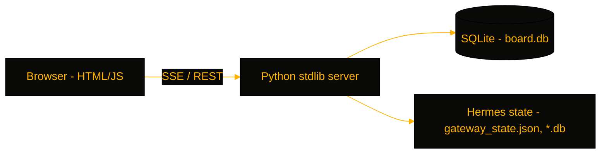

# OpsCenter

> A single-file, dependency-free operations dashboard for AI agent fleets — live agent state, a task board, session history, and system health in one dark UI, for operators running Hermes agents.

[](https://github.com/OneByJorah/OpsCenter)
[](https://github.com/OneByJorah/OpsCenter)
[](https://github.com/OneByJorah/OpsCenter/stargazers)
[](https://github.com/OneByJorah/OpsCenter/commits)


## What This Is

OpsCenter shows what your AI agents are doing right now. It reads the Hermes agent state directory (`gateway_state.json`, `state.db`, `agent-logs.db`, `kanban.db`) and renders agents, sessions, health, cron jobs, and a task board in one real-time view. It is deliberately minimal: one Python file on the standard library serving a vanilla HTML/JS frontend — no pip installs, no build step.

## Quick Start

```bash
git clone https://github.com/OneByJorah/OpsCenter.git
cd OpsCenter
python3 server.py
```

Open `http://localhost:51763`. For Docker: `cp .env.example .env && docker compose up -d`.

## Features

- Live agent monitoring from Hermes state — subagent status and activity
- Kanban task board persisted in SQLite (`board.db`)
- Historical session log of agent runs and outcomes
- Token analytics — LLM usage and cost visibility from gateway state
- Server-Sent Events stream (`/events`) pushes snapshots to the UI in real time
- Markdown content editor with list/read/save endpoints
- 3D topology view of distributed agent nodes
- Optional API-key guard on write endpoints

## Architecture



OpsCenter reads `HERMES_HOME` (default `../.hermes`) and starts with empty state if it is absent.

## Stack

Python 3.11 standard library, http.server, SQLite, Server-Sent Events, vanilla HTML/CSS/JS, Docker Compose

## Contributing

Contributions are welcome — see [CONTRIBUTING.md](CONTRIBUTING.md) and [open an issue](https://github.com/OneByJorah/OpsCenter/issues).

## License

MIT — see [LICENSE](LICENSE).
