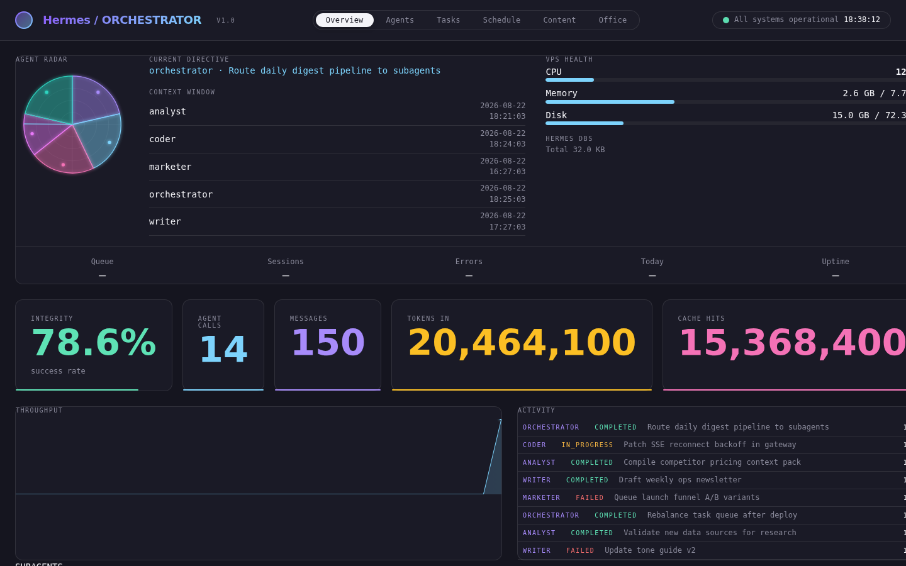

<div align="center">


# OpsCenter

AI agent operations dashboard


</div>

---

<p align="center">
  
</p>

<br>

---

## Features

- **Live Agent Monitoring** — Real-time visibility into subagent status and activity.
- **Task Board** — Kanban-style task management for agent operations.
- **Session Tracking** — Historical log of agent sessions and outcomes.
- **Token Analytics** — Usage tracking and cost monitoring for LLM calls.
- **System Health** — Server resource monitoring and alerting.
- **Server-Sent Events** — Live streaming of agent state changes.
- **Dark-Themed UI** — Professional, easy-on-the-eyes operations interface.
- **Fleet Visualization** — 3D topology view of distributed agent nodes.

## Quick Start

OpsCenter is a single self-contained Python app — standard library only, no pip dependencies.

```bash
git clone https://github.com/OneByJorah/OpsCenter.git
cd OpsCenter
python3 server.py
```

Open **http://localhost:51763** in your browser.

### Using the Start Script

```bash
chmod +x start.sh
./start.sh
```

## Environment Variables

| Variable | Default | Description |
|----------|---------|-------------|
| `PORT` | `51763` | Dashboard server port |
| `BIND` | `127.0.0.1` | Server bind address |
| `HERMES_HOME` | `../.hermes` | Path to the Hermes agent home directory |
| `MISSION_CONTROL_API_KEY` | *(empty)* | API key protecting write endpoints (task board, content editor) via the `X-API-Key` header |
| `MISSION_CONTROL_CONTENT_DIR` | `./content` | Markdown content directory for the editor |

## Architecture

```
Browser (HTML/JS) ──SSE / REST──▶ Python Server ──▶ SQLite
                                      │
                                      ▼
                              Agent Gateway API
```

## Project Structure

```
OpsCenter/
├── server.py              # Python backend (WebSocket + API)
├── app.js                 # Frontend application logic
├── components.js          # Reusable UI components
├── index.html             # Main dashboard page
├── tokens.css             # Token-themed styling
├── test.html              # UI test page
├── board.db               # SQLite database (auto-created)
├── backups/               # Historical source snapshots
├── start.sh               # Quick-start script
└── server.log             # Runtime logs
```

## API Endpoints

| Endpoint | Method | Description |
|----------|--------|-------------|
| `/` | GET | Main dashboard UI |
| `/api/snapshot` | GET | Full dashboard snapshot (agents, sessions, health, cron, board) |
| `/events` | GET (SSE) | Live snapshot stream |
| `/api/health` | GET | Liveness probe |
| `/api/board` | GET/POST | List / create tasks |
| `/api/board/update?id=` | POST | Update a task |
| `/api/board/delete?id=` | POST | Delete a task |
| `/api/content` | GET | List markdown content files |
| `/api/content/get?path=` | GET | Read a markdown file |
| `/api/content/save` | POST | Save a markdown file |

## Development

```bash
python3 server.py

# Serve the repo statically (UI test page, no API)
python3 -m http.server 8081
```

## Deployment

OpsCenter ships with a Dockerfile and docker-compose configuration for self-hosting.

```bash
cp .env.example .env
docker compose up -d
```

## Contributing

Contributions are welcome. Please see [CONTRIBUTING.md](CONTRIBUTING.md) for guidelines and [CODE_OF_CONDUCT.md](CODE_OF_CONDUCT.md) for community standards.

## Security

Found a vulnerability? Please follow our [Security Policy](SECURITY.md) and report privately to `security@jorahone.com`.

## License

[MIT License](LICENSE) © Jhonattan L. Jimenez (OneByJorah)

---

<p align="center">Built with 🌴 by <a href="https://github.com/OneByJorah">OneByJorah</a> · <a href="https://jorahone.com">jorahone.com</a></p>
