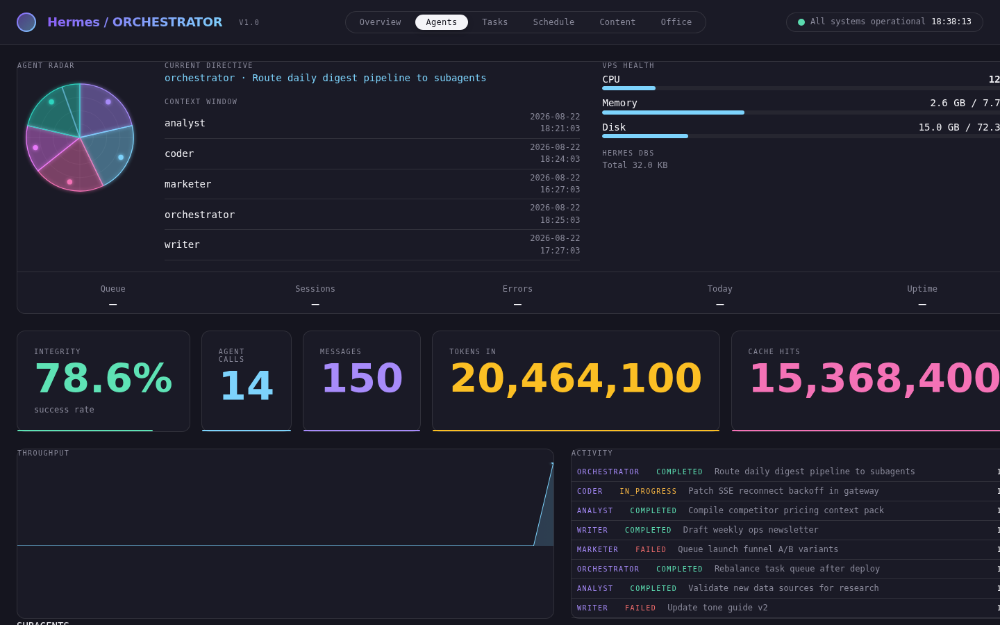
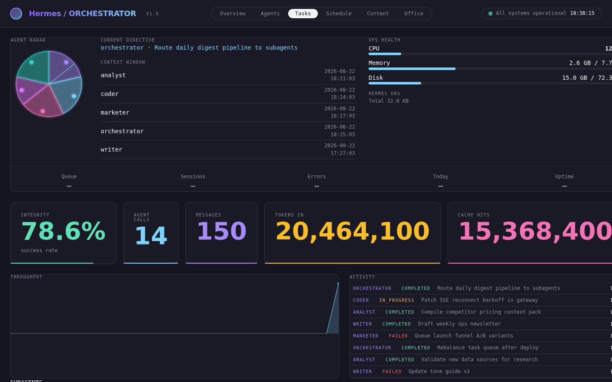

<div align="center">


# OpsCenter

**A single-file, dependency-free operations dashboard for AI agent fleets — live agent state, a task board, session history, and system health in one dark-themed UI.**

<a href="https://github.com/OneByJorah/OpsCenter/stargazers"></a>
<a href="https://github.com/OneByJorah/OpsCenter/commits"></a>


</div>


## What This Is

OpsCenter gives you visibility into what your AI agents are doing right now. It reads the Hermes agent state directory (`gateway_state.json`, `state.db`, `agent-logs.db`, `kanban.db`) and renders agents, sessions, health, cron jobs, and a task board in a single real-time view.

It is deliberately minimal: one Python file using only the standard library, serving a vanilla HTML/JS frontend. There are no pip dependencies to install and no build step.

## Quick Start

```bash
git clone https://github.com/OneByJorah/OpsCenter.git
cd OpsCenter
python3 server.py
```

Open **http://localhost:51763**. Or, for Docker:

```bash
cp .env.example .env
docker compose up -d
```

> [!NOTE]
> OpsCenter reads agent state from `HERMES_HOME` (defaults to `../.hermes`). If that directory is absent the dashboard still starts and reports empty state.

## Features

- **Live agent monitoring** — current subagent status and activity pulled from Hermes state.
- **Kanban task board** — create, update, and delete tasks persisted in `board.db`.
- **Session tracking** — historical log of agent sessions and outcomes.
- **Token analytics** — LLM usage and cost visibility from gateway state.
- **System health** — server resource monitoring and threshold alerts.
- **Server-Sent Events** — `/events` streams snapshot changes to the UI in real time.
- **Content editor** — list, read, and save markdown files under the content directory.
- **Fleet visualization** — 3D topology view of distributed agent nodes.

## Architecture

```
Browser (HTML/JS) ──SSE / REST──▶ Python stdlib server ──▶ SQLite (board.db)
                                        │
                                        ▼
                              Hermes state (gateway_state.json, *.db)
```

## Configuration

| Variable | Default | Description |
|----------|---------|-------------|
| `PORT` | `51763` | Dashboard server port |
| `BIND` | `127.0.0.1` | Server bind address |
| `HERMES_HOME` | `../.hermes` | Path to the Hermes agent home directory |
| `MISSION_CONTROL_API_KEY` | *(empty)* | API key protecting write endpoints (`X-API-Key` header) |
| `MISSION_CONTROL_CONTENT_DIR` | `./content` | Markdown content directory for the editor |

> [!WARNING]
> Set `MISSION_CONTROL_API_KEY` to protect the board and content write endpoints before exposing OpsCenter on a network. Keep `BIND` at `127.0.0.1` unless you intend remote access.

## API Endpoints

| Endpoint | Method | Description |
|----------|--------|-------------|
| `/` | GET | Main dashboard UI |
| `/api/snapshot` | GET | Full snapshot (agents, sessions, health, cron, board) |
| `/events` | GET (SSE) | Live snapshot stream |
| `/api/health` | GET | Liveness probe |
| `/api/board` | GET/POST | List / create tasks |
| `/api/board/update?id=` | POST | Update a task |
| `/api/board/delete?id=` | POST | Delete a task |
| `/api/content` | GET | List markdown content files |
| `/api/content/get?path=` | GET | Read a markdown file |
| `/api/content/save` | POST | Save a markdown file |

## Use Cases

1. **Agent operators** — watch subagent activity and intervene from the task board.
2. **Homelab AI stacks** — pair with Hermes to track sessions and token usage.
3. **Ops on a budget** — run a zero-dependency dashboard in an Alpine container.

## Tech Stack

Python 3.11 (standard library), `http.server`/`socketserver`, SQLite, SSE, vanilla HTML/CSS/JS, Docker Compose.

## Screenshots

| Dashboard | Agents | Tasks |
|---|---|---|
|  |  |  |

A short `docs/assets/demo.gif` walkthrough is also included.

## Contributing

Contributions are welcome — see [CONTRIBUTING.md](CONTRIBUTING.md). [Open an issue](https://github.com/OneByJorah/OpsCenter/issues) to report a bug or request a feature.

## License

MIT — see [LICENSE](LICENSE).

## Connect

- [jorahone.com](https://jorahone.com)
- [GitHub Org](https://github.com/OneByJorah)
- [info@jorahone.com](mailto:info@jorahone.com)
